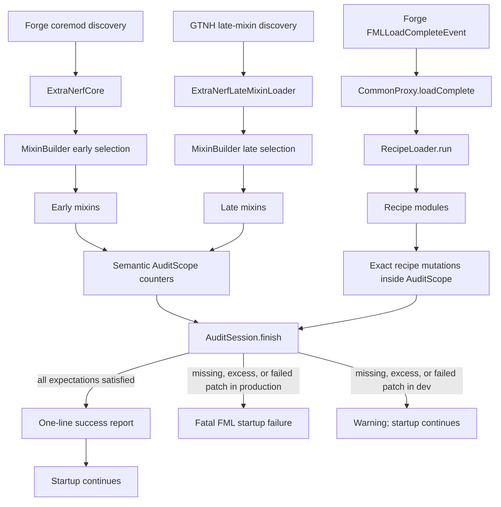

# Architecture

## Electric Iron Bath

`IronBathMaterials` owns the independent metal registrations and processing
identities. `IronBathAlloyRecipes` owns recurring alloy demand and acquisition
guards through recipe transactions. Native Forestry comb processing and alloy
decomposition keep their original outputs. `IronBathLootModule` owns the
corresponding ELB reward restrictions in the existing loot pipeline.

`IronBath` owns the persistent metal, carbon, queued metals, heat, impurities,
Calcite reserve and slag. Items with identical item data and progress form charge groups
with a shared per-item heat value. Groups consume paid coil heat in proportion
to their item counts and join the bath together after one heating stage. The charge budget
includes the energy carried by molten metal at 1,700 K. Unpowered charges can cool
into a colder bath. `MTEIronBathFurnace` connects that process to native GT
power, maintenance, buffered inventories and the physical structure.
Coil tier determines bath capacity, the automatic temperature ceiling and the
Calcite reserve. The reserve starts at 180 units and gains 160 per coil tier.
Stored units survive a downgrade, with refilling paused until below the new limit.
Metal admission reserves queued volume and leaves 1/32 of the tank for slag.
Total stored and queued material cannot exceed tank capacity. Carbon additives
enter the bath directly within constituent limits. Calcite binding uses free
volume after queued metal reservations.
`IronBath.configure` preserves the contents and heating
progress when applying a fitting coil configuration.
`MTEIronBathTap` exposes extracted material through an ordinary output tank and
supports rising-edge, powered, continuous and stopped operation.
Its rising-edge history is saved with the hatch. Each metal discharge keeps the
product selected at its start, with quantity bounded by available metal and carbon.

The controller shares one paid EU allowance between charge processing and bath
heating. Native coil bonuses apply to charge processing. Direct bath heating
uses a fixed heat conversion. The automatic ceiling is 2200 K plus 900 K per coil
tier. Natural carbon burning grows sublinearly above 2200 K.

`IronBathGui` synchronizes bath measurements while the player views the panel.
Temperature is displayed as actual temperature and coil ceiling.
The tank shows resident metal and floating slag through melting and freezing.
Solid portions use a fixed frame of the native molten texture sheet. Liquid
portions use the animated atlas with a temperature-driven pulsing overlay.
Melting groups share a source item, count and processing progress. The controller
displays the melting item count, one icon per group and pages through distinct groups. The composition
scale includes pure Iron, uses the shared NEI material palette and
labels the highlighted product below its active band. Layer tooltips combine
total and molten quantities, showing the molten amount during partial freezing.
The panel retains native maintenance hints and structure errors.
Early automation observes the extracted products. Input buses admit carbon additives
directly and queue metal within the volume limits. Oxygen hatches share a bounded
per-tick flow budget. Redstone triggers taps in five equal-height bands. The bath selects slag whenever
liquid slag overlaps the requested band, then metal if no slag is present. The native overclock calculator
uses EBF voltage, amperage, heat-discount and perfect-overclock rules. Structure
validation permits up to eight energy hatches.

The optional LuV `MTEIronBathMeasurement` fits the side platform's measurement position.
`IronBathMeasurementDriver` exposes it through an OpenComputers Adapter as
`iron_bath_measurement`. Its server-thread `read` callback returns a fresh snapshot
from the controller while the controller is formed (as of its last structure check),
both tiles are live and the hatch is installed. Reads never rescan the structure.
The controller remains the owner of measured state.

`IronBathMaterials` registers independent Wrought Iron, Overcarburized Iron and
Slag forms before GT generates items and fluids. `IronBathFurnace` owns the
machine catalog, construction recipes, casting recipes and NEI material balances.
`IronBathRecipeHandler` draws NEI diagrams for the product bands and carbon
additives. It derives additive quantities from the registered material balances
and routes native item and fluid searches to the corresponding product.
The monochrome vessel illustration uses native GT slots and shaded arrows,
following the HTGR and purification-machine diagrams.
Its symmetric front elevation shows Oxygen entering from below and separate
outlets for the upper Slag layer and lower metal layer.
`IronBathStructure` defines the refractory chimney, exposed coil banks, Steel
Frames and raised feed conveyor. Its named port offsets place the controller,
buffered inputs and maintenance on the side platform, energy at the chimney base,
and tapping hatches along the neck. Construction and validation share its shape
and controller offsets. Tap rows map to band indices in the bath. Band boundaries follow tank capacity,
independently of the controller's elevation.
`IronBathCasings` registers dedicated refractory side and top textures. Reinforced
walls use a separate side texture with Wrought Iron straps. Both casing variants
use the refractory brick top.
World and controller-item NBT share the same process serialization.

## Bee recipe inputs

`ChemicalAndMiscNerf` owns the Liquid Crystal Kevlar ingredient changes through
the transactional editor. `MixinKevlarBeeInput` adapts the native input matcher
for required Kevlar drones. Forestry owns active species resolution. GregTech
retains lookup, counting and consumption. `MixinKevlarBeeMutation` changes the
resource before Forestry constructs the condition and description.

## Native lootbag integration

`MixinLootGroupsHandler` patches ELB's newly deserialized local tables before
publication. `LootLoader` runs typed `LootModule` audits; `NativeLootTables` edits
native objects and recalculates weights. ELB owns the source tables, merged caches,
RNG, native player limits, delivery and NEI data. Startup requires one successful
`MODIFY_ME_CONTROLLER_LOOT` change and `VERIFY_NATIVE_LOOT_TABLES`; later reloads
use fresh audit sessions with the same scopes.

`MixinItemLootBag` wraps native opening only to enforce global claims via
`ServerLootRuntime`/`GlobalLootLimits`. `FileLootLedger` retains its v1 format and
force-before-spawn behavior. Only limited rewards append new claims. The controller
key remains `gtnhextranerf:me_controller`, with one unit per save. While unspent,
the first opening whose merged pool contains the controller guarantees it in one
native draw slot; subsequent openings retain the global exclusion.
Native storage handles and our runtime reset between saves; old journal player
counts remain a floor for ELB's own counters. `LootAllowanceSync` sends the
controller allowance on login and changes; `LootAllowancePreview` ties it to the
current connection. A client-only mixin replaces the controller's cached tooltip
on display, and explains the meaning of other entries' native weight percentages.

See [`../docs/LOOTBAG_SYSTEM_DESIGN.md`](../docs/LOOTBAG_SYSTEM_DESIGN.md).

## Questbook crafting tasks

`MixinCraftingTaskRetrieval` adds inventory and observation interfaces to every
BQ Standard `TaskCrafting` while retaining native craft, smelt, anvil and
statistics behavior. `CraftingTaskRetrieval` uses the native non-consuming
retrieval detector with the original requirements and matching flags. Crafting
and retrieval keep separate per-player progress; the maximum for each required
item determines completion without counting the same item twice. The client-only
`MixinCraftingTaskRetrievalGui` displays the combined progress. The original
factory ID and saved crafting progress remain intact; retrieval progress is
stored in an additional namespaced task-progress tag.

## Purpose and operating model

Machine certification is owned by `MachineProgression`. The shared tile tick gate
pauses basic machines, Steam controllers and electric multiblocks with gated
energy/dynamo hatches. `MixinMultiblockCertification` checks again after native
structure validation, before recipe processing, so newly loaded controllers cannot
lose a batch through a locked hatch. Native recipe fields remain the saved state.
`MachineProgression` remembers the overworld `ProgressionData` record between
queries, re-reads it at the start of each server tick and drops it when the
server stops.

GTNH Extra Nerf is a compatibility-sensitive balance mod for a specific GTNH
snapshot. It changes
upstream behavior through mixins during class/recipe registration and through
exact recipe-map mutations after all normal registration has completed.

The design deliberately favors an explicit production startup failure over
silently running with missing or partially applied nerfs. Deobfuscated
development launches are the sole exception: they log skipped patches and
audit gaps so reduced local runtimes can remain usable.

## Loading lifecycle

### Forge mod lifecycle

`GTNHExtraNerf` owns the Forge event handlers and delegates all of them to a
sided proxy. Lifecycle handlers include:

- `preInit` reads the legacy configuration (`Config.synchronizeConfiguration`),
  initializes telemetry and team tracking, and registers blocks, items,
  components, certificates, exams and event handlers.
- `init` registers the Brainrotter and Iron Bath machines and, with
  OpenComputers, the measurement driver.
- `postInit` registers the raw machine casing groups.
- `loadComplete` runs recipe patches, finalizes `AuditSession`, and releases
  mutable audit state after creating an immutable report.
- `serverStarting` starts the loot runtime, loads the world's reporting choice
  (`Config.loadWorld`), starts telemetry, team tracking, the consent prompt and
  the update checker, and registers the server commands.
- `serverStopped` stops those services and resets per-world state.

`ClientProxy` additionally registers the loot allowance preview, client
commands, item renderers, NEI integration, tooltips and menu branding, opens
URLs, certificates and exams, and shows integrity failures on the client
startup error screen.

### Early mixin phase

`ExtraNerfCore` is both an FML core plugin and an `IEarlyMixinLoader`. The
root JAR manifest points FML at this class. It returns
`mixins.gtnhextranerf.early.json` and selects entries that provide
access required before the normal mod lifecycle:

- descriptor-safe access to the Minecraft crafting recipe list, `IRecipe`
  operations and Forge shaped-recipe mirroring;
- small Naquadah ore generation;
- GregTech breeder and radioactive-cell construction;
- the client-only startup error screen (`MixinFMLClientHandler`).

### Late mixin phase

`ExtraNerfLateMixinLoader` is discovered through GTNH Mixins and returns
`mixins.gtnhextranerf.late.json`. The `Mixin` enum uses `MixinBuilder` to
select entries whose phase and mod requirements match.

Important limitation: most enum entries currently declare only `GREGTECH`,
including mixins whose target classes actually live in Dreamcraft, BartWorks,
or GT++. The full GTNH pack satisfies those implicit requirements, but a
reduced installation may not.

## Two patch mechanisms

### Registration-time mixins

Mixins are used when the desired change is easiest or safest while upstream is
constructing a value or registering a recipe. Techniques include:

- `@Redirect` for constructor calls and the LCR tooltip;
- MixinExtras `@ModifyReceiver` and `@WrapOperation` for validated recipe
  builders and calls;
- MixinExtras `@ModifyReturnValue` for targeted return-value changes;
- cancellable `@Inject` for tier-gated circuit widget selection;
- `@ModifyArg` for material fuel values;
- `@ModifyConstant` for the steam conversion constants.

The generator mixins delegate their tier-relative percentage policy to
`GeneratorEfficiency`. Steam Turbine converts the shared percentage back into
the inverse consumption value expected by its upstream `getEfficiency()`
contract.

The cutter mixin filters ordinary and distilled water at the shared recipe-map
emitter boundary; other input fluids are left alone. Metal transmutation mixins
adapt the original registrations before Thaumcraft research pages and NEI
consume the resulting recipes.

Mixins that own audited behavior open a typed `AuditScope` and record semantic
recipe/value changes only after their target is confirmed. Missing injector
targets still fail through Mixin's own required-injection checks.

### Load-complete recipe mutation

`RecipeLoader` registers the recipe modules in execution order. The modules
implement `RecipeModule` and register ordered `RecipeModifier`
callbacks with `RecipeRegistry`. Each active `AuditScope` owns one modifier.
Activation, audit capture and development failure handling are centralized in
the registry. A `RecipeContext` provides machine/crafting adapters backed by one
`RecipeTransaction` per modifier. Planning resolves every target before any
registry is written. Both development and production use this same path.

Machine recipes are identified by exact multisets of item inputs, item
outputs, fluid inputs, fluid outputs, duration, EU/t and, where relevant,
output chances or special values. Crafting recipes are identified by an
actual 3x3 probe plus expected output.

## Audit model

`AuditScope` implements the state-free `AuditDefinition` interface. Activation
and typed `AuditExpectation` values are resolved at finalization. Expectations
generate their own descriptions; the enum has no global-statistics lookup.

`AuditSession` owns one-use `AuditHandle` objects, synchronized per-thread stacks
and primitive aggregate counters. Callbacks record normal return or failure;
closing a manual handle without an explicit outcome is a failure. Nested time
is subtracted only from the parent on the same thread. No public handle pooling
or ThreadLocal/global reset is used. The static `AuditManager` only bridges
mixin/lifecycle entry points to the startup session.

`finish()` rejects active handles without disabling the session, then returns
an immutable `AuditReport` containing counts, run outcomes, reasons, expectations
and exclusive times. Mutable accumulators/thread references are released, but
the report survives. Missing active scopes, failed/skipped active executions
and count mismatches fail validation. Inactive definitions do not resolve their
optional expectations.

`RecipeRegistry` receives a session and named failure policy; it records counts
only after transaction commit. Development can continue after explicit recipe
validation failures, which remain FAILED in the report. Arbitrary programmer,
backend-write and rollback failures remain fatal. `CommonProxy` reports success
only for an accepted report with no startup exception, and retains the original
cause if finalization also fails. See `docs/AUDIT_SYSTEM.md` for contracts and limits.

## Recipe mutation guarantees and limits

`RecipeEditor` stages additions, removals and replacements against snapshots.
It enforces exact cardinality, distinct additions and replacement validation.
`RecipeTransaction` validates registry identities before committing and restores
every attempted store in reverse order on a write failure. A failed restoration
raises `RecipeRollbackException` and remains fatal in development.

`RecipeMatch.builder()` defines immutable machine signatures through named
input/output, duration, EU/t, chance and special-value fields. Explicit empty
arrays require absence; omitted fields remain unrestricted. Alternative recipes
use `RecipeMatch.anyOf` rather than predicate chains.

`MachineRecipes` copies recipes before modification, preserving metadata,
category, alternative ingredients and chance arrays. Its adapter applies only
the recipe differences through GT backend methods so lookup indexes are rebuilt.
Additions use the upstream emitters and transformers without registering during
planning, then validate signatures and input collisions.

`CraftingRecipes` uses typed recipe handles and copied nine-slot probes.
`RecipeChange.builder()` describes ordered machine changes by ingredient/output
identity. `MachineRecipes` accepts this definition and owns detached application.
`CraftingRecipeBuilder` produces immutable `CraftingDefinition` objects whose
pattern/bindings supply both probes and construction arguments. Ingredients use
the immutable `CraftingIngredient` interface and item/OreDict implementations;
only the native factory converts them to upstream `Object` arguments. `toBuilder()`
changes a definition without duplicating its grid. The internal
`CraftingRecipeFactory` calls GT and Dreamcraft constructors directly, with no
reflection. Existing early accessor interfaces isolate Minecraft's `IRecipe`
descriptors, access the crafting list and configure mirroring. Output-count edits
retain the original recipe instance and are restored on rollback.

The transaction boundary is one modifier, including all maps it touches.
Earlier successful modifiers remain committed if a later modifier fails.
Arbitrary side effects outside `RecipeContext` are not transactional, and this
is a synchronous load-complete API rather than a concurrent editor. Exact
signatures remain coupled to the pinned upstream versions. Registration-time
mixins and machine behavior mixins retain their own lifecycle.

See [`../docs/RECIPE_SYSTEM.md`](../docs/RECIPE_SYSTEM.md) for the public API,
extension examples, compatibility boundary and architectural assessment.

## Build architecture

The root build uses `pluginManagement.includeBuild("gradle/GTNHGradle")`. The
submodule supplies the GTNH convention plugin and the full-pack client/server
tasks. The root project adds only:

- two pinned mod dependencies;
- JUnit Jupiter;
- `fullPack.cleanServerRuntime` for the CI path only (`-PfullPackCi`);
- CI-specific server configuration.

The distributable JAR is a combined FML mod/coremod with the early loader,
Mixin tweaker, mixin JSON files, refmap, mod metadata, and reobfuscated
production classes.

Client fatal startup errors are deferred by `ClientProxy` and raised after
`Loader.initializeMods()` via the client-only early `MixinFMLClientHandler`.
Forge catches the display exception and shows its built-in error screen.
`StartupErrorRequest` supplies the constant-backed support message and guards
the dev-only preview flag; the common/server proxy does not link client GUI types.

## Integration-test lifecycle

Opt-in Horizon-QA builds register fixture alternatives during Forge pre-init.
The framework bootstraps an isolated integrated world and runs selected scenarios
after normal server startup. GUI operations use its client-thread queue and
native input, while machine assertions run on the server thread. Reported
completion drives JSON/JUnit output and client shutdown through the pinned
portable supervisor. Manual `runFullPack` launches retain their normal lifecycle.

The Kevlar lock adapter delegates input counting and consumption to the same native recipe owner. RecipeChange normalizes guaranteed input chances with the GT helper so native lock serialization compares equivalent representations.
