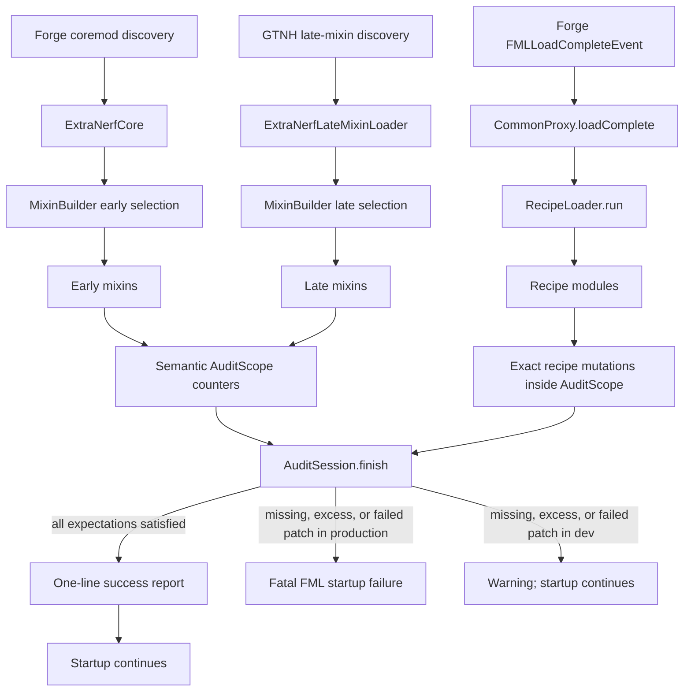

# Architecture

## Native lootbag integration

`MixinLootGroupsHandler` patches ELB's newly deserialized local tables before
publication. `LootLoader` runs typed `LootModule` audits; `NativeLootTables` edits
native objects and recalculates weights. ELB owns the source tables, merged caches,
RNG, native player limits, delivery and NEI data. Startup requires one successful
`MODIFY_ME_CONTROLLER_LOOT` change and `VERIFY_NATIVE_LOOT_TABLES`; later reloads
use fresh audit sessions with the same scopes.

`MixinItemLootBag` wraps native opening only to enforce global claims via
`ServerLootRuntime`/`GlobalLootLimits`. `FileLootLedger` retains its v1 format and
force-before-spawn behavior. Only limited rewards append new claims. The controller
key remains `gtnhextranerf:me_controller`, with one unit per save and no guarantee.
Native storage handles and our runtime reset between saves; old journal player
counts remain a floor for ELB's own counters. `LootAllowanceSync` sends the
controller allowance on login and changes; `LootAllowancePreview` ties it to the
current connection. A client-only mixin replaces the controller's cached tooltip
on display, and explains the meaning of other entries' native weight percentages.

See [`../docs/LOOTBAG_SYSTEM_DESIGN.md`](../docs/LOOTBAG_SYSTEM_DESIGN.md).

## Machine-casing quest compatibility

`MixinCasingQuestCrafting` augments native Detect and
`MixinCasingQuestInventory` uses BetterQuesting's existing inventory-change
queue. `CasingQuest` accepts the exact finished LV casing only for quest UUID
`00000000-0000-0000-0000-000000000049`, task 0, after validating the task's
required item. The native crafting task records progress and synchronizes it;
the item is not consumed. The quest database and saved task type are not
rewritten, so the same check applies to freshly loaded and reloaded questbooks.

## Purpose and operating model

GTNH Extra Nerf is a compatibility-sensitive balance mod for a specific GTNH
snapshot. It changes
upstream behavior through mixins during class/recipe registration and through
exact recipe-map mutations after all normal registration has completed.

The design deliberately favors an explicit production startup failure over
silently running with missing or partially applied nerfs. Deobfuscated
development launches are the sole exception: they log skipped patches and
audit gaps so reduced local runtimes can remain usable.

## Loading lifecycle

### Forge mod lifecycle

`GTNHExtraNerf` owns the Forge event handlers and delegates all of them to a
sided proxy. Lifecycle handlers include:

- `preInit` calls `Config.synchronizeConfiguration`.
- `loadComplete` runs recipe patches, finalizes `AuditSession`, and releases
  mutable audit state after creating an immutable report.

`init`, `postInit`, `serverStarting`, and all client-specific proxy behavior
are currently empty.

### Early mixin phase

`ExtraNerfCore` is both an FML core plugin and an `IEarlyMixinLoader`. The
root JAR manifest points FML at this class. It returns
`mixins.gtnhextranerf.early.json` and selects entries that provide
access required before the normal mod lifecycle:

- descriptor-safe access to the Minecraft crafting recipe list, `IRecipe`
  operations and Forge shaped-recipe mirroring;
- small Naquadah ore generation;
- GregTech breeder and radioactive-cell construction;
- the client-only startup error screen (`MixinFMLClientHandler`).

### Late mixin phase

`ExtraNerfLateMixinLoader` is discovered through GTNH Mixins and returns
`mixins.gtnhextranerf.late.json`. The `Mixin` enum uses `MixinBuilder` to
select entries whose phase and mod requirements match.

Important limitation: most enum entries currently declare only `GREGTECH`,
including mixins whose target classes actually live in Dreamcraft, BartWorks,
or GT++. The full GTNH pack satisfies those implicit requirements, but a
reduced installation may not.

## Two patch mechanisms

### Registration-time mixins

Mixins are used when the desired change is easiest or safest while upstream is
constructing a value or registering a recipe. Techniques include:

- `@Redirect` for constructor calls and the LCR tooltip;
- MixinExtras `@ModifyReceiver` and `@WrapOperation` for validated recipe
  builders and calls;
- MixinExtras `@ModifyReturnValue` for targeted return-value changes;
- cancellable `@Inject` for tier-gated circuit widget selection;
- `@ModifyArg` for material fuel values;
- `@ModifyConstant` for the steam conversion constants.

The generator mixins delegate their tier-relative percentage policy to
`GeneratorEfficiency`. Steam Turbine converts the shared percentage back into
the inverse consumption value expected by its upstream `getEfficiency()`
contract.

Mixins that own audited behavior open a typed `AuditScope` and record semantic
recipe/value changes only after their target is confirmed. Missing injector
targets still fail through Mixin's own required-injection checks.

### Load-complete recipe mutation

`RecipeLoader` registers the recipe modules in execution order. The modules
implement `RecipeModule` and register ordered `RecipeModifier`
callbacks with `RecipeRegistry`. Each active `AuditScope` owns one modifier.
Activation, audit capture and development failure handling are centralized in
the registry. A `RecipeContext` provides machine/crafting adapters backed by one
`RecipeTransaction` per modifier. Planning resolves every target before any
registry is written. Both development and production use this same path.

Machine recipes are identified by exact multisets of item inputs, item
outputs, fluid inputs, fluid outputs, duration, EU/t and, where relevant,
output chances or special values. Crafting recipes are identified by an
actual 3x3 probe plus expected output.

## Audit model

`AuditScope` implements the state-free `AuditDefinition` interface. Activation
and typed `AuditExpectation` values are resolved at finalization. Expectations
generate their own descriptions; the enum has no global-statistics lookup.

`AuditSession` owns one-use `AuditHandle` objects, synchronized per-thread stacks
and primitive aggregate counters. Callbacks record normal return or failure;
closing a manual handle without an explicit outcome is a failure. Nested time
is subtracted only from the parent on the same thread. No public handle pooling
or ThreadLocal/global reset is used. The static `AuditManager` only bridges
mixin/lifecycle entry points to the startup session.

`finish()` rejects active handles without disabling the session, then returns
an immutable `AuditReport` containing counts, run outcomes, reasons, expectations
and exclusive times. Mutable accumulators/thread references are released, but
the report survives. Missing active scopes, failed/skipped active executions
and count mismatches fail validation. Inactive definitions do not resolve their
optional expectations.

`RecipeRegistry` receives a session and named failure policy; it records counts
only after transaction commit. Development can continue after explicit recipe
validation failures, which remain FAILED in the report. Arbitrary programmer,
backend-write and rollback failures remain fatal. `CommonProxy` reports success
only for an accepted report with no startup exception, and retains the original
cause if finalization also fails. See `docs/AUDIT_SYSTEM.md` for contracts and limits.

## Recipe mutation guarantees and limits

`RecipeEditor` stages additions, removals and replacements against snapshots.
It enforces exact cardinality, distinct additions and replacement validation.
`RecipeTransaction` validates registry identities before committing and restores
every attempted store in reverse order on a write failure. A failed restoration
raises `RecipeRollbackException` and remains fatal in development.

`RecipeMatch.builder()` defines immutable machine signatures through named
input/output, duration, EU/t, chance and special-value fields. Explicit empty
arrays require absence; omitted fields remain unrestricted. Alternative recipes
use `RecipeMatch.anyOf` rather than predicate chains.

`MachineRecipes` copies recipes before modification, preserving metadata,
category, alternative ingredients and chance arrays. Its adapter applies only
the recipe differences through GT backend methods so lookup indexes are rebuilt.
Additions use the upstream emitters and transformers without registering during
planning, then validate signatures and input collisions.

`CraftingRecipes` uses typed recipe handles and copied nine-slot probes.
`RecipeChange.builder()` describes ordered machine changes by ingredient/output
identity. `MachineRecipes` accepts this definition and owns detached application.
`CraftingRecipeBuilder` produces immutable `CraftingDefinition` objects whose
pattern/bindings supply both probes and construction arguments. Ingredients use
the immutable `CraftingIngredient` interface and item/OreDict implementations;
only the native factory converts them to upstream `Object` arguments. `toBuilder()`
changes a definition without duplicating its grid. The internal
`CraftingRecipeFactory` calls GT and Dreamcraft constructors directly, with no
reflection. Existing early accessor interfaces isolate Minecraft's `IRecipe`
descriptors, access the crafting list and configure mirroring. Output-count edits
retain the original recipe instance and are restored on rollback.

The transaction boundary is one modifier, including all maps it touches.
Earlier successful modifiers remain committed if a later modifier fails.
Arbitrary side effects outside `RecipeContext` are not transactional, and this
is a synchronous load-complete API rather than a concurrent editor. Exact
signatures remain coupled to the pinned upstream versions. Registration-time
mixins and machine behavior mixins retain their own lifecycle.

See [`../docs/RECIPE_SYSTEM.md`](../docs/RECIPE_SYSTEM.md) for the public API,
extension examples, compatibility boundary and architectural assessment.

## Build architecture

The root build uses `pluginManagement.includeBuild("gradle/GTNHGradle")`. The
submodule supplies the GTNH convention plugin and the full-pack client/server
tasks. The root project adds only:

- two pinned mod dependencies;
- JUnit Jupiter;
- `fullPack.cleanServerRuntime = true`;
- CI-specific server configuration.

The distributable JAR is a combined FML mod/coremod with the early loader,
Mixin tweaker, mixin JSON files, refmap, mod metadata, and reobfuscated
production classes.

Client fatal startup errors are deferred by `ClientProxy` and raised after
`Loader.initializeMods()` via the client-only early `MixinFMLClientHandler`.
Forge catches the display exception and shows its built-in error screen.
`StartupErrorRequest` supplies the constant-backed support message and guards
the dev-only preview flag; the common/server proxy does not link client GUI types.

## Integration-test lifecycle

Opt-in Horizon-QA builds register fixture alternatives during Forge pre-init.
The framework bootstraps an isolated integrated world and runs selected scenarios
after normal server startup. GUI operations use its client-thread queue and
native input, while machine assertions run on the server thread. Reported
completion drives JSON/JUnit output and client shutdown through the pinned
portable supervisor. Manual `runFullPack` launches retain their normal lifecycle.
