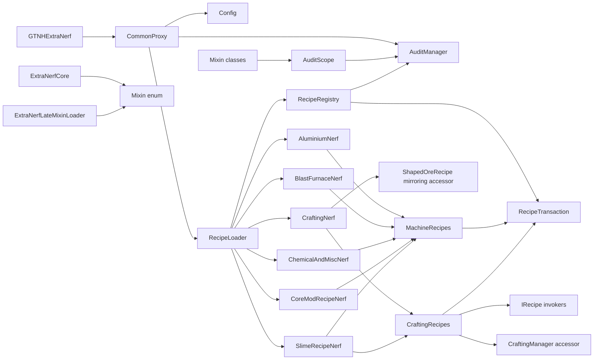

# File relationships

This document maps runtime calls, shared data and upstream coupling. It is
intended for impact analysis before editing a file.

## Native loot tables and global runtime

`ReloadLootGroups -> VerifyConfig` is wrapped by `MixinLootGroupsHandler`.
Successful local parsing invokes `LootLoader.patch -> LootModule.apply/verify`
before ELB publishes either native table reference and clears its merged cache.
`NativeLootTables` replaces native entries and recalculates cached weight totals.
`CommonProxy` verifies the published result in the startup audit; subsequent file
reloads create new audit sessions. Client header packets skip the full-table patch.

`MixinItemLootBag` calls the original ELB opening. It filters unavailable global
rewards, forces a claim after native stack materialization, and observes native
spawn results. `ServerLootRuntime -> GlobalLootLimits -> FileLootLedger` owns only
that allowance. It does not own XML, RNG, normal rewards or native player DBs.
`MixinLootGroupsHandler` also preserves legacy journal player counts and exposes
a native DB-handle reset for save switching. `MixinLootBagCommand` permits audited
file reloads and blocks inline table edits that would bypass this boundary.
`LootAllowanceSync` publishes the ledger-backed snapshot at login and after
changes; `LootAllowancePreview` rejects packets from previous connections.
`MixinLootBagPreview` supplies the live tooltip when ELB appends its cached text.

## Questbook crafting tasks

`MixinCraftingTaskRetrieval` adds BQ's inventory and observation interfaces to
every `TaskCrafting` while preserving native production events. Its adapter,
`CraftingTaskRetrieval`, keeps separate native retrieval progress;
`CraftingTaskProgress` exposes the combined per-item view. The client-only GUI
mixin presents both methods. The original task ID and existing progress remain
intact, with retrieval progress saved in an additional namespaced NBT tag.

## Top-level runtime graph

## Core orchestration relationships

`CommonProxy.loadComplete` defers recipe edits and `AuditManager.finish` to
`GregTechAPI.sGTCompleteLoad` when that queue is still pending; otherwise it
executes immediately. NHCore registers Space Assembler recipes in this queue.
`NativeScenarios.recipes` calls `MixinRecipeIntegrationTests` after Horizon-QA
starts its scratch server, so final-registry checks run after the mod callback
and GregTech's late loaders.

`RecipeItems.requireModItem` is shared by `Ae2RecipeNerf`,
`Ae2AssemblyLineRecipes` and `IntergalacticRecipeNerf`. It wraps GregTech's
nullable lookup with the recipe system's typed validation exception, including
mod id, item name and metadata in diagnostics. NHCore's placeholder/exception
lookup policy is a different contract.

`IntergalacticRecipeNerf` is registered by `RecipeLoader`. Its optional audit
scope requires GTNH Intergalactic, AE2 and AE2 Fluid Craft. It resolves the
Space Assembler map through GregTech's public recipe-map registry and replaces
the Proxy's exact UEV Sensor input with a stack from `ComponentLoader`.

| File | Calls/uses | Called/loaded by | Change impact |
| --- | --- | --- | --- |
| `GTNHExtraNerf.java` | `CommonProxy`, generated `Tags.VERSION`, Launch blackboard | Forge mod discovery | Mod ID, dependencies, lifecycle, proxy names and development-environment detection are integration contracts. |
| `CommonProxy.java` | `Config`, `BlightedSoybean`, `MagicnetizedManasteelRod`, `ComponentLoader`, `RecipeLoader`, `AuditManager`, `FMLCommonHandler` | `GTNHExtraNerf` | Registers items before recipes; only deobfuscated dev launches tolerate final audit gaps. |
| `items/BlightedSoybean.java` | Forge `GameRegistry`, GregTech materials tab | `CommonProxy.preInit`, `MixinSoybeanCrop`, NEI integration | Registers the replacement item and substitutes the specific HarvestCraft soybean item in crop drops. |
| `items/MagicnetizedManasteelRod.java` | Forge `GameRegistry`, Thaumcraft, Botania, GregTech OreDict | `CommonProxy`, motor recipe modules and Arcane Workbench mixins | Registers the MV motor ingredient and arcane recipe; supplies crafting remainders. |
| `ClientProxy.java` | `CommonProxy`, `ComponentItemRenderer`, startup-error display | `@SidedProxy` on clients | Keeps component renderers and error-screen behavior on the client. |
| `components/ComponentRegistry.java` | `ComponentTier`, `ComponentType`, `ComponentItem` | `ComponentLoader`, client renderer/NEI integration, recipe consumers | Owns all identities and returns fresh stacks; never eagerly resolves GregTech appearance sources. |
| `loader/ComponentLoader.java` | `ComponentRegistry`, Forge `GameRegistry` | `CommonProxy.preInit` | Registry names are save-data contracts; registers items once on both sides. |
| `client/ComponentItemRenderer.java` | Source `IItemRenderer`, copied appearance stacks | `ClientProxy.init` | Uses real UEV rendering, including material effects. |
| `client/nei/NEIExtraNerfConfig.java` | `BlightedSoybean`, `ComponentLoader`, NEI handlers, `API.hideItem`, wildcard stacks | NEI plugin discovery; client handler-info event | Hides item-panel entries and registers information pages and their dimensions. |
| `client/nei/UfoAssemblerRecipeHandler.java` | Component/fabrication catalogs, localized text, owned sprites and GT GUI textures | NEI recipe/usage/catalyst queries | One cached UEV + part -> UQV display per component; UFO opens eight pages; no gameplay recipes or transfer overlay. |
| `fabrication/UfoAssemblyRegistry.java` | `FabricationIngredient`, `FabricationItem`, component identities | `ComponentLoader`, NEI integration | Complete, unique component/part mapping with independent native item identities. |
| `Config.java` | Forge `Configuration` | `CommonProxy.preInit` | No properties are defined; adding one requires human docs and migration defaults. |
| `audit/AuditScope.java` | `AuditDefinition`, `AuditExpectation`, optional-mod checks | loaders, mixins, session | State-free activation and count contracts. |
| `audit/AuditManager.java` | `AuditSession` | lifecycle and mixin entry points | Narrow bridge to the startup session. |
| `audit/AuditSession.java` | definitions, handles, counts, results, report | registry and manager | Thread/LIFO ownership, exclusive time and atomic finalization. |
| `audit/AuditReport.java` | immutable `AuditResult` and `AuditCounts` | lifecycle and diagnostics | Retains evidence after mutable session cleanup. |

The CI harness searches logs for the exact prefix
`GTNH Extra Nerf integrity check failed`. Preserve it or update
`.github/scripts/run_full_pack_server.py` and its tests in the same change.

## Recipe layer relationships

| Owner | Shared helper | Upstream maps/systems | Failure boundary |
| --- | --- | --- | --- |
| `CraftingNerf` | `CraftingRecipes` | Minecraft `CraftingManager`, Dreamcraft universal recipes, `GTShapedRecipe` | One typed scope per logical crafting nerf |
| `AluminiumNerf` | `MachineRecipes` | chemical bath, mixer, centrifuge maps | Typed scopes |
| `BlastFurnaceNerf` | `MachineRecipes` | primitive blast furnace and EBF maps, Railcraft Coke, BartWorks gases, optional TConstruct item | Typed scopes |
| `ChemicalAndMiscNerf` | `MachineRecipes` and `CraftingRecipes` | chemical reactor, LCR, cutter, distillery, centrifuge, electrolyzer, chemical bath, blast furnace | Typed scopes |
| `CoreModRecipeNerf` | `MachineRecipes` | assembler, circuit assembler, chemical maps, mixer, centrifuge, vacuum furnace | Typed scopes |
| `Ae2RecipeNerf` | `MachineRecipes`, `CraftingRecipes`, `Ae2RecipeIngredients` | AE2-owned outputs in GT maps; Controller and Blank Pattern crafting | Load-complete scopes; shared crafting material rule audited during registration |
| `Ae2AssemblyLineRecipes` | Native GT Assembly Line builder | Controller production, 64k cell research, Scanner and NEI entries | One audited addition after recipe modifications |
| `SlimeRecipeNerf` | `MachineRecipes` and `CraftingRecipes` | extractor, centrifuge, multiblock centrifuge, assembler and Minecraft crafting | Typed scopes with TConstruct/GT++/EMT/NHCore activation contracts |

`RecipeLoader` registers `RecipeModule` implementations in a
`RecipeRegistry`. Modules register `RecipeModifier` callbacks, and the registry
selects active `AuditScope`s and opens one transaction per callback. It owns
audit recording and development failure handling.

`RecipeContext` caches one `MachineRecipes` editor per map and one
`CraftingRecipes` editor. Both delegate to `RecipeEditor` and `RecipeTransaction`.
`MachineRecipeStore` updates backend indexes; `CraftingRecipeStore` preserves
crafting order and restores output-count edits. `RecipeMatch` exposes an
immutable signature with a fluent builder; the package-private
`MachineRecipeSelector` implements ingredient multiset comparison.
`MachineRecipeCopies` preserves recipe metadata and
detaches mutable arrays. `RecipeChange` encapsulates ordered, identity-based edits and alternative/chance
consistency. `CraftingRecipeBuilder` snapshots into `CraftingDefinition`, which
derives probes and delegates native construction to the factory. Both use typed
`CraftingIngredient` values; a visitor converts item/OreDict variants at the
upstream constructor boundary. Internal `CraftingTarget` owns copied probes and output/type
matching. `CraftingRecipeFactory` uses direct constructors and the mirroring
accessor; `CraftingRecipe` hides the raw Minecraft handle behind the existing
output/matching accessor interface. There is no reflection in this layer.

## Mixin selection and audit relationships

`ExtraNerfCore` and `ExtraNerfLateMixinLoader` do not enumerate classes
themselves. Both delegate to the `Mixin` enum. Each enum constant owns a
`MixinBuilder` with:

- the simple class name;
- an explicit early or late phase;
- required/excluded mods where applicable.

If a mixin starts or stops recording semantic recipe changes, update all of
the following together:

1. the corresponding constant and criteria in `AuditScope`;
2. the mixin implementation;
3. a targeted behavior test where practical;
4. `AI/PATCH_CATALOG.md` and `docs/NERFS.md`.

## Mixin-to-target matrix

| Mixin | Target owner | Injection kind | Semantic selection |
| --- | --- | --- | --- |
| `MixinCraftingManagerAccessor` | Minecraft | `@Accessor` | private raw `recipes` list |
| `MixinRecipeAccessor` | Minecraft | 2 `@Invoker`s | `IRecipe.getRecipeOutput` and `matches` |
| `MixinShapedOreRecipeAccessor` | Forge | `@Accessor` | private `mirrored` flag |
| `MixinSoybeanCrop` | HarvestCraft | `@ModifyReturnValue(require = 2)` | crop and seed return values equal to `harvestcraft:soybeanItem` |
| `MixinArcaneCraftingRemainders` | Thaumcraft | `@WrapMethod` + `@WrapOperation` | Magicnetized Manasteel Rod crafting remainders and scheduling inventory synchronization |
| `MixinAe2Crafting` | NHCore | 3 `@WrapOperation` handlers | shared AE2-output/Titanium ingredient selection across crafting registration APIs |
| `MixinWirelessConnectionPower` | AE2 | 1 `@WrapMethod` replacing power recalculation | distance^4 EU/t capped at 10,000,000 per link, split across endpoints; hubs sum their shares |
| `MixinMeP2PChannelCapacity` | AE2 | 1 `@Inject` at constructor return | standard eight-channel external node capacity, shared across output branches |
| `MixinSmallOres` | GregTech | `@WrapOperation` invocation | `builder.smallOreName == ore.small.naquadah` |
| `MixinLoaderGTBlockFluid` | GregTech | 2 constructor redirects | unlocalized name checks |
| `MixinMTESteamTurbine` | GregTech | `@ModifyReturnValue` | shared `GeneratorEfficiency` curve represented as steam consumption |
| `MixinMTEPlasmaGenerator` | GregTech | `@ModifyReturnValue` | shared `GeneratorEfficiency` curve starting at EV |
| `MixinSteamInputHatch` | GT++ | `@ModifyConstant` | 64,000 L Steam Hatch registration capacity |
| `MixinSteamOverclockDescriber` | GregTech | private static `@ModifyConstant` | shared single-block NEI conversion multiplier |
| `MixinSteamMachineTank` | GregTech | 2 `@ModifyConstant`s | Bronze/Steel fluid tank amount and capacity |
| `MixinSteamMachineDisplay` | GregTech | 1 `@ModifyConstant` | single-block steam WAILA usage |
| `MixinSteamMachineGui` | GregTech | 2 `@ModifyArg`s | Bronze/Steel ModularUI 2 steam gauge suppliers |
| `MixinSteamMultiBlock` | GregTech/GT++ | `@WrapOperation` + `@ModifyConstant` | fivefold running steam drain and WAILA usage, excluding Steam Water Pump |
| `MixinSteamMultiBlockWailaData` | GregTech | `@Inject` at WAILA data return | native integer steam cost for multiblocks, excluding Steam Water Pump |
| `MixinMTEDieselGenerator` | GregTech | `@ModifyReturnValue` | shared `GeneratorEfficiency` curve starting at LV |
| `MixinMTEGasTurbine` | GregTech | `@ModifyReturnValue` | shared `GeneratorEfficiency` curve starting at LV |
| `MixinMTELargeChemicalReactor` | GregTech | `@ModifyReturnValue` + redirect | returned processing logic and tooltip call |
| `MixinHealingAxeHunger` | Extra Utilities | `@Inject` + `@WrapOperation` | `ItemHealingAxe.onUpdate`, with item marking and `HungryAxe` food-state handling |
| `MixinLootBagPreview` | EnhancedLootBags/NEI | `@WrapOperation` | Dynamic controller allowance tooltip and qualification of native percentages/counters |
| `MixinCraftingTaskRetrieval` | BetterQuesting | `@Inject` + interfaces | Adds non-consuming retrieval alongside crafting tasks |
| `MixinCraftingTaskRetrievalGui` | BetterQuesting | client-only `@Inject` | Combined crafting/retrieval name and task panel |
| `MixinMetaTileEntity` | GregTech | `@ModifyConstant(require = 2, allow = 2)` | two literal `2` values in `fill`, replaced by the shared steam conversion |
| `MixinConfigurationCircuitSupport` | GregTech | cancellable `@Inject(require = 1)` | `CommonWidgets.createCircuitSlot`; physical circuit for every tiered pre-HV machine with configuration-circuit support |
| `MixinPhysicalCircuitBlockDrop`, `MixinPhysicalCircuitExplosionDrop` | GregTech | 2 `@WrapOperation(require = 1)` | Share `PhysicalCircuitSlots` eligibility with the GUI; include real reserved-slot circuits in native block and explosion drops |
| `MixinCraftingMaterialLoader` | BartWorks | `@WrapOperation` | exact ring pattern and output material association |
| `MixinMTESemiFluidGenerator` | GT++ | `@ModifyReturnValue` | shared `GeneratorEfficiency` curve starting at LV |
| `MixinProcessingWire` | GregTech | `@ModifyReceiver` | every `addTo` receiver, then map/prefix/material/recipe-shape validation |
| `MixinCircuitAssemblerRecipes` | Dreamcraft | `@WrapOperation` | circuit assembler map plus nano/quantum output identity; sixfold inputs capped at 64 |
| `MixinMetaGeneratedItem01` | GregTech | `@WrapOperation` | LV motor result and exact iron/steel patterns |
| `MixinMaterialsInit` | GregTech | 2 `@ModifyArg`s | exact `setFuel` calls in benzene/phenol loaders |
| `MixinProcessingShaping` | GregTech | `@WrapOperation` | `addCraftingRecipe` calls whose output has the `ring` prefix |
| `MixinAssemblyLineRecipes` | GregTech | `@ModifyReceiver` | assembly-line map, Fusion Computer output and exact Dense Netherite input |

Receiver/wrapper mixins still depend on upstream invocation descriptors, but
their semantic predicates prevent an unrelated builder or crafting call from
being modified.

## Resource and manifest relationships

| Resource | Consumer |
| --- | --- |
| `mixins.gtnhextranerf.json` | Mixin tweaker from the JAR manifest; declares shared refmap. |
| `mixins.gtnhextranerf.early.json` | `ExtraNerfCore.getMixinConfig()`. |
| `mixins.gtnhextranerf.late.json` | `ExtraNerfLateMixinLoader.getMixinConfig()`. |
| `mixins.gtnhextranerf.refmap.json` | Generated by the Mixin annotation processor and packaged into the JAR. |
| `mcmod.info` | Forge metadata processing with Gradle token substitution. |
| generated `Tags` class | `GTNHExtraNerf` version annotation. |

`gradle.properties` connects these pieces through `usesMixins`,
`coreModClass`, `mixinsPackage`, token generation, mod ID and Maven publishing
settings.

## Test-to-production matrix

| Production area | Direct tests | Integration coverage |
| --- | --- | --- |
| `RecipeRegistry` / `AuditScope` | `RecipeRegistryTest` verifies ordered execution and committed audit counts | Full-pack harness rejects audit prefix in logs. |
| `RecipeEditor` / `RecipeTransaction` | `RecipeEditorTest`, `RecipeTransactionTest` | Full-pack server exercises live adapters and rollback boundaries. |
| Item/fluid multiset comparison | No registry bootstrap in unit tests | Full-pack server. |
| Recipe port behavior | None at root | Full-pack server. |
| Mixin targeting/content | Mixin annotation processor during compilation | Full-pack server. |
| Industrial and Alloy Blast Smelter recipes | Exact recipe signatures and `AuditScope` cardinalities | `IndustrialRecipeIntegrationTests` and `AlloyBlastSmelterIntegrationTests` query the final initialized machine maps. |
| Physical circuit drops | `PhysicalCircuitItemStackHandlerTest` covers insertion and extraction | `PhysicalCircuitDropIntegrationTests` checks real machine and input-bus destruction, NBT, explosion drops and HV ghost circuits. |
| Lootbag preview | Native loot/ledger tests | `LootPreviewScenarios` exercises the live NEI tooltip while the server claims and reopens the world allowance. |
| Questbook crafting tasks | Native BQ quest and task APIs | Quest scenarios exercise inventory retrieval, Detect, hand Chisel, item matching, non-consumption and questbook reload. |
| Hungry Axe | `HungryAxeTest` covers marking and hunger bounds | `HealingAxeIntegrationTests` exercises the registered item through actual dedicated-server inventory ticks and checks food state. |
| Lightning Rod generation | Startup audit checks all three native registrations and output ratings | `LightningRodIntegrationTests` drives real server weather, mast geometry and public post-ticks; stored EU, fence consumption and fixed-seed comparisons verify the behavior. |
| Void Miner gas costs | Startup audit checks hooks, registrations and native gas ordering | `VoidMinerFluidIntegrationTests` drives formed miners and compares hatch payments, powered output, short/exact supply and batch scaling for every tier/gas pair. |
| Spatial Assembly Lines | Startup audit verifies both target hooks, controllers and error localization | `SpatialAssemblyIntegrationTests` checks native structures, hidden errors, client serialization and actual processing in AE2-created worlds. |
| Server harness | Python unittest with fake Gradle/server | GitHub Actions full-pack server job. |
| GTNHGradle full-pack implementation | Tests inside submodule | Root full-pack server job. |

Recipe ports and mixin behavior currently rely on compilation checks and the
full-pack server rather than assertions over production source text.

## External dependency ownership

The root directly declares GT5-Unofficial, NewHorizonsCoreMod and
EnhancedLootBags, plus compile-only BetterQuesting, Chisel, Extra Utilities, Custom Main Menu
and ChromaticTooltips and a development-only NEI dependency. The GT5 development
artifact also exposes types from merged addons used by the source. Runtime code
interacts with BartWorks, Dreamcraft, Good Generator, GT++, GTNH Lanthanides,
TConstruct, Thaumcraft, Botania and optionally Forestry and HarvestCraft.

Before changing dependency declarations, distinguish:

- compile classpath exposure through the two dev artifacts;
- Forge runtime dependency metadata;
- mixin selection requirements;
- optional code paths guarded by mod detection;
- assumptions that are valid only in the complete GTNH pack.

`CommonProxy.handleIntegrityFailure` is fatal on dedicated servers; `ClientProxy`
queues a `StartupErrorRequest`. The early client FML handler hook raises it
inside the existing custom-error catch, and Forge owns the non-dismissable GUI.
The preview property is forwarded by Gradle only to `runClient`; the client
also checks Forge's deobfuscated-environment flag.

## Horizon-QA execution

`.github/scripts/run_horizon_tests.py` pins and prepares the framework from
Horizon-QA PR 263, then invokes its portable supervisor. The supervisor passes
`horizonQaIntegration` and `horizonQaHome` to `gradle/horizon-tests.gradle`.
That build script includes fixtures and prepares the invocation-owned full pack.

`IntegrationFixtures` registers test OreDictionary alternatives during pre-init.
`NativeScenarios` invokes native recipe, machine, loot and telemetry checks after
the scratch world starts. `ArcaneWorkbenchScenarios` drives the real client GUI
and checks server consumption, retained flowers and client inventory updates.
`BrainrotterDevelopmentTests` supplies the reduced-runtime HQA holder.

`MixinArcaneCraftingRemainders` requests an inventory snapshot after each
completed Magicnetized Rod craft. `recipes/crafting/ArcaneWorkbenchSync` sends pending snapshots at
server tick END, after vanilla's click transaction, and coalesces requests per
player. `CommonProxy` registers the listener and clears pending work on stop.
