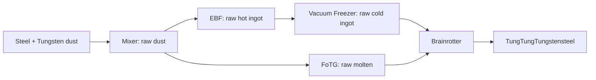

# Brainrot materials and Industrial Brainrotter

The existing GregTech `TungstenSteel` material is displayed as **TungTungTungstensteel**. Its material ID (316), item metadata, ore names and molten
fluid identity remain the existing GT identities. Previously saved items still
resolve to this material. The current IV casing recipes continue to consume
its double plates.

The finished material's tooltip displays a bundled Tung Tung Tung Sahur image
instead of a chemical formula. Its steel/tungsten composition and physics are
unchanged, and the raw material retains its ordinary formula. Client-only
tooltip events handle the image; no extra mixin is needed. In the full pack,
Chromatic Tooltips receives a native image section, including for NEI and
ModularUI2 item tooltips. Chromatic Tooltips Compat replaces NEI's renderer and
bypasses the GTNHLib render event; the GTNHLib/ModularUI2 hooks remain available
when that renderer is absent. The image respects native tooltip pagination.
See the image's [source and rights designation](../src/main/resources/assets/gtnhextranerf/textures/gui/tooltips/SOURCES.md).

A separate material, `RawTungstenSteel`, is displayed as **Tungstensteel**.
It is the input to the Industrial Brainrotter. Its fixed GT material
ID is 859; that number must remain stable after worlds use it. Registration
rejects occupied IDs or names rather than picking a different ID at runtime.
Its ore names use `RawTungstenSteel` and its molten fluid is separate from the
finished material's `molten.tungstensteel`.

The raw material uses the original Tungstensteel tint and dye color, including
its item and molten colors, rather than a separate gray tint.
The raw material has standard GT dust, ingot, hot ingot, plate, double plate
and storage-block forms. GT handles the metal items, fluids, textures and
processing. Its storage block reuses GT's `BlockMetal` and existing steel
block texture, registered as `gtnhextranerf:raw_tungstensteel_block`. It has
steel/tungsten composition and a 4000 K blast temperature, matching the base
material's thermal properties. It does not unify into the finished material.
Automatic blast-furnace and vacuum-freezer recipes are disabled for the new
material. Cooling is registered explicitly using the pack's existing tungstensteel
Vacuum Freezer duration and energy cost, so GT does not generate a cheaper route.
Primary production is registered explicitly from the pack's existing recipes.

## Current implementation stage

Fresh production requires the Brainrotter. Both the regular and multiblock
Steel + Tungsten mixer tables now produce raw Tungstensteel dust. The two
Quantum Force ore-processing routes (Lead/Bauxite/Tungstate and
Rutile/Scheelite/Ilmenite) also output raw dust, preserving their other products,
amounts, chances and catalyst metadata. All nine existing blast-furnace variants have
raw-material versions, retaining the original gases, durations, voltage and heat
metadata. Their hot raw ingots must be cooled in the Vacuum Freezer before refining.

FoTG builds its molten recipes on world entry from the EBF map. It therefore
derives raw molten Tungstensteel from the new raw recipes automatically; this
fluid is also accepted by the Brainrotter. A required hook audits those recipes
after native generation, using a fresh audit session because startup auditing
has already finished. A failure is fatal in the full pack and logged without
aborting the development environment.



Existing finished-material blast and recycling recipes remain usable with
already-finished stock, including old saves and parts containing this material.
The fresh Steel + Tungsten mixer no longer supplies their finished-dust input.
Raw ore names never unify into finished ore names. IV casings and other existing
consumers still require the finished material.

## Multiblock structure

**Industrial Brainrotter** uses the supplied 5×5×3 Structure Writer design.
The controller replaces `G` at the center of the front row in the bottom layer.
The structure's offsets are `(2, 4, 0)` for checking, hints and construction.
Its transposed scan is:

```text
FFDFF / FDADF / FFDFF
BBBBB / BIIIB / BBBBB
BBBBB / BJ-MB / BBBBB
BBBBB / BHEKB / BBBBB
WL~WW / WCCCW / WWWWW
```

| Symbol | Required block |
| --- | --- |
| A | Extra Utilities timer; pulse metadata may change |
| B | Any glass registered in GT's tiered glass chain; all positions share a tier |
| C | Mycelium |
| D | Railcraft Force Track Emitter |
| E | Railcraft Routing Switch Motor |
| F | `Forestry:logsFireproof`, any species and log orientation |
| W | Same fireproof logs, or a GT hatch/bus |
| H | Thaumcraft pedestal (`blockStoneDevice:1`), with its real pedestal tile |
| I | Vanilla skull block; head type and orientation are unrestricted |
| J | Thaumic Exploration Think Tank (`thinkTankJar:0`) |
| K | Ordinary Thaumcraft table (`blockTable:0` or `1`, its two orientations) |
| L | Railcraft Feed Station |
| M | Railcraft Distant Signal |
| ~ | Controller |
| - | Air |

Railcraft block/metadata pairs are taken from its registered machine and signal
items. Those decorative tiles are validated as blocks and are not added to any
controller list. The pedestal is the sole additional tile connection. A structure
scan binds its live tile and clears the connection for invalid structures.
The connection is reacquired through scanning after loading.

The skull element uses the real `Items.skull` item for survival construction and
NEI preview. Vanilla skull blocks have no ordinary ItemBlock; passing them to
StructureLib's default survival helper crashes both inventory construction and
BlockRenderer6343's preview. The dedicated element places the skull block, preserves
its type/player-owner NBT and charges one actual skull. It skips existing skulls
and rejects missing materials without changing the world. Direct block placement
is needed because the middle skull in the supplied design floats above air.

Replace logs in the bottom layer with at least one input bus, one output bus,
one fluid output hatch, one energy hatch and exactly one maintenance hatch. A fluid input hatch is
optional for molten material. Upper logs remain fixed fireproof wood.
EV power is required by the prototype recipes. GT's construction hints and
survival construction are supported.

### Reduced development runtime

Only in deobfuscated development runs, missing structure blocks use vanilla
placeholders. Available mod blocks keep their normal requirements.

| Missing block | Development placeholder |
| --- | --- |
| Forestry fireproof logs | Logs |
| Extra Utilities timer | Redstone block |
| Railcraft Force Track Emitter | Iron block |
| Railcraft Routing Switch Motor | Emerald block |
| Thaumcraft pedestal | Gold block |
| Thaumic Exploration Think Tank | Bookshelf |
| Thaumcraft table | Crafting table |
| Railcraft Feed Station | Hay bale |
| Railcraft Distant Signal | Lapis block |

Without the pedestal block, development recipes skip its occupancy check,
display item and completion/theft check. Inputs, outputs, energy, glass-tier
limits and required hatches still work normally. If a real pedestal is available
in development, the normal pedestal mechanics remain enabled.

Production never uses placeholders or skips pedestal mechanics. The startup
Brainrotter audit builds the structure definition too, so a missing required
block is diagnosed before a world tick or construction preview can reach it.

The controller is made in an EV assembler from an EV machine casing, an EV
sensor, two EV electric pistons and four EV circuits. Its stable meta-tile ID is
32400; an occupied ID fails registration rather than silently replacing another
machine. The registered name is `multimachine.gtnhextranerf.brainrotter`.

Craft a generic **Brainrot Compilation** from a GT data stick
and a book, then keep it in an input bus. It is required but never consumed.
Supply **Wood Pulp**, the standard GT wood dust, as the consumed ingredient
directing the transformation into TungTungTungstensteel. The compilation
does not encode a material or store a selected recipe. Future brainrots can use
the same compilation with different consumed ingredients and ordinary GT recipes.
The compilation has a custom pixel-art vinyl icon with a paper label, drawn
at 16 pixels and exported at 32×32 pixels using nearest-neighbor scaling.
The controller and compilation crafting recipes remain prototype recipes.

| Input, together with the compilation | Output | Time | Power |
| --- | --- | --- | --- |
| 1 cooled raw Tungstensteel ingot + 1 Wood Pulp | 1 finished ingot | 10 s | EV |
| 144 mB raw molten Tungstensteel + 1 Wood Pulp | 144 mB finished molten | 10 s | EV |

Hot ingots are rejected by the Brainrotter. The ingot route requires cooling the
raw hot ingot in a Vacuum Freezer first. Molten remains a valid alternative input
and does not require conversion into an ingot before refining.

The shell uses GT's `chainAllGlasses`: any registered glass is supported, with all
positions sharing the same voltage tier. Energy hatches may not exceed that tier.
Laser receivers require at least UEV glass, with the same upper bound on hatch tier.
Normal and exotic energy inputs use GT's native energy lists and draining.

Each overclock multiplies EU/t by four and divides duration by three. The parallel
limit is `1 + 2 * max(0, energyVoltageTier - recipeVoltageTier)`, calculated for
the matched recipe, so future recipes do not inherit a fixed EV baseline. For an
EV recipe the limits are EV=1, IV=3, LuV=5, UEV=13 and UXV=19. GT's sub-tick
parallel multiplier is disabled to keep this limit; batch mode remains sequential
batching. Amperage contributes available power but does not add voltage overclocks.

Controller and hatch backgrounds share a pixel wood casing. The controller has
its own CRT/knob/lamp front, with separate active and emissive layers. Casing
texture ID `(127 << 7) | 124` is checked for collisions at registration and verified
by the machine audit. The ordinary item tooltip retains only power/performance
rules; ingredient details are shown by recipes.

The pedestal must be empty to start; an occupied pedestal prevents input consumption.
After GT commits the input transaction, the controller places one raw Tungstensteel
ingot on it, including for the molten recipe. Thaumcraft's renderer makes it float
and rotate, and its tile packets synchronize it to clients.

The display ingot carries a unique NBT marker for that processing cycle. Immediately
before releasing any output, the controller verifies the item, amount and complete
NBT. A missing or replaced marker critically stops the machine and discards all pending
outputs; the consumed inputs are not refunded. This applies to the whole batch,
regardless of output quantity. Putting an ordinary raw ingot in its place does not
satisfy the check. Removing and returning the same marker before completion is allowed;
the contract checks its presence at completion.

Successful completion removes the display before the next recipe can start.
Cancellation, power loss, a broken structure or controller removal also removes
the controller's own display, leaving a replacement item intact. The controller
saves the expected marker and pedestal coordinates alongside GT's processing NBT;
Thaumcraft saves the displayed stack. Unloading preserves the active cycle, and
loading does not recreate a stolen marker. Existing active saves without marker
state stop safely rather than release unverified output.

Processing, energy, hatch inventories, maintenance, output protection, batch mode
and the machine UI use GT's multiblock implementation. `MTEIndustrialBrainrotter` owns the structure;
its shape and construction offsets can be replaced with Structure Writer output
without changing recipes. `Brainrotter` owns the controller, compilation and
audited recipe registration.

## Implementation and verification

`NerfMaterials` is one small definition/audit class, without a new registry
framework. The existing `MixinMaterialsInit` renames the finished definition
and registers a GT material callback. That callback runs after built-in IDs
are assigned and before the generated material array/items are created.
The common proxy registers the storage block during pre-initialization and
runs `VERIFY_BRAINROT_MATERIALS` after GT finishes loading.

The audit checks fixed identities, the renamed finished material, generated
forms, separate ore names and molten fluids. Native full-pack tests query the
real GT registries and restore an old `gregtech:gt.metaitem.01` ingot save with
metadata 11316. Native casing checks exercise IV crafting and assembly with the finished
material and reject raw plates. English resources define the material names.

`ADD_BRAINROTTER_RECIPES` accounts for the two Brainrotter processing recipes,
raw hot-ingot cooling, controller assembly and compilation crafting. The cooling
addition requires exactly one existing finished-material cooling recipe as its
cost reference and is published through the audited GT backend with rebuilt
lookup indexes. `VERIFY_BRAINROTTER` checks the published
machine, item and processing map. Native server tests construct real GT tiles,
check a complete and damaged shell, reject hot ingots, then process cooled ingots
and molten material through real hatch inventories and server ticks. They check
input and energy consumption, output, the reusable compilation and processing
stopping while the structure is broken. A compilation without Wood Pulp cannot
start processing; both solid and molten routes consume the directional ingredient.
Pedestal checks cover occupied-slot preflight, the visible raw ingot after input
withdrawal, stolen and replaced markers (including one from a previous cycle),
power loss, structure loss and controller removal. Native controller/pedestal NBT
round trips exercise an overclocked batch, exactly-once output after loading and
aborting a loaded batch whose marker was removed.
Survival construction tests also remove the three skulls, reject an empty
inventory, rebuild them from actual skull items without exceptions, preserve their
type, consume exactly three items and skip already completed positions.
Power tests use native glass, normal and laser energy hatches, reject under-tier
glass and lasers below UEV, prove voltage-specific input consumption, and verify
the 3/4 overclock's time/energy relationship on real server ticks. Molten refining
outputs native finished fluid through an actual output hatch.

`REROUTE_TUNGSTEN_STEEL_PRODUCTION` requires two mixer replacements, two Quantum
Force replacements and nine EBF
additions. `TungstenSteelProduction` contains the concrete routing and checks;
it uses the existing recipe transaction and GT backend. EBF variants are detached
copies that preserve metadata, chances and alternatives. Native world-entry
cache rebuilding is exercised before querying the full mixer → EBF → freezer →
Brainrotter chain and the FoTG → Brainrotter branch. The late FoTG audit requires
one correctly derived molten recipe for each raw EBF variant.
Published-map verification checks both mixer tables and the Quantum Force table,
then scans every registered GT recipe map for finished-material output from fresh
Steel/Tungsten dust inputs. Native recipe queries exercise the multiblock mixer
and both Quantum Force routes after world-entry cache rebuilding.

## Planned presentation

The supplied structure is implemented. The proposed machine presentation is an industrial record player: a
rotating compilation, a small monitor and three successive TUNG pulses. An
alternative GUI shows three hammer strokes as a mechanical sequencer.
Both are presentation concepts, not implemented machine screens.

For the world animation, a visible drum rotates while a wooden hammer strikes
three times per visual cycle; indicator lamps pulse with the strikes. The glass
shell can expose this mechanism. The controller
can render the moving parts through GT's existing `IMTERenderer` interface without
placing and removing blocks during processing. The implemented pedestal display
already floats and rotates through Thaumcraft's native renderer.

GUI animation should use ModularUI's synchronized machine progress. World motion
should run on the client from GT's synchronized activity; a visual phase or recipe
identity can be synchronized through GT's renderer data if later required.
Animations stop when the server reports that processing has stopped. Resource
consumption, recipe selection and output remain exclusively on the server.
No per-frame packets or independent processing state are needed.

## NEI presentation

`BrainrotterFrontend` is attached to the existing GT recipe map. GT's native NEI
handler owns recipe lookup, item/fluid alternatives, quantities, overclock
information, tooltips and bookmarks. No second recipe list or handler registration
is introduced.

The layout shows the base material on the left, the reusable compilation above
the gramophone, the consumed direction ingredient below it, and output on the
right. Both solid and molten recipes use this same layout. GT creates its usual
positioned stacks from phantom slot bindings; frontend preparation moves those
display stacks to their roles without editing recipe data. Coordinates remain
relative to GT's recipe window, including its native offset. This custom panel
explicitly sets its background offset to zero: GT's usual 3×3 background padding
would otherwise shift the painted slots relative to their item positions.

A pixel-art gramophone turns its disc, animates its CRT signal and flashes three
TUNG lamps. Its eight-frame sprite sheet advances from NEI's client draw ticks;
this is a local preview with no machine state, sound or server packets. Visible
Reusable/Consumed labels and ingredient tooltips explain each role. The native
GT description below the panel displays the actual recipe time and power.

The item and GUI have their own industrial gramophone palette: graphite, dark
wood, brass details and an amber CRT. They use nearest-neighbor scaling,
generated reproducibly by `tools/draw_brainrotter_textures.py`. The PNG
and GIF under `build/` preview the shipped assets and layout; they are not
in-game screenshots. The standard machine GUI and world renderer still await
the planned presentation work described above.
