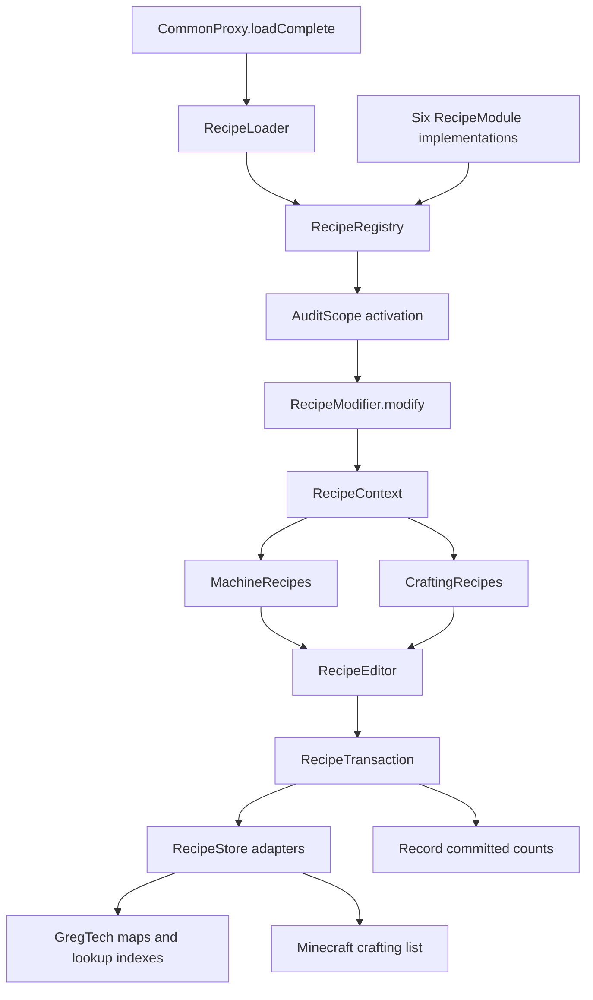

# Recipe modification system

The load-complete edits and final audit run after GregTech's late recipe queue.
If `GregTechAPI.sGTCompleteLoad` still exists when Extra Nerf receives Forge's
`FMLLoadCompleteEvent`, `CommonProxy` appends its callback to that queue. If GT
has already completed the queue, the callback runs immediately. This also
handles dev launches where GT receives the event after Extra Nerf: NHCore's
Space Assembler recipes are registered in the GT queue and must exist before
the Proxy recipe is edited. The Forge integration fixture uses the same timing
so it inspects the final edited registries.

The recipe layer separates balance rules, execution and registry access. All
load-complete modules implement `RecipeModule` and register their changes
with `RecipeRegistry`. A `RecipeModifier` receives a `RecipeContext` and plans
edits through its machine or crafting API. Registration itself does not resolve
ingredients or change recipes.



## Registering a modifier

Add the logical scope and its expected counts to `AuditScope`, then register a
method or a class implementing `RecipeModifier` in the appropriate module:

```java
@Override
public void register(RecipeRegistry registry) {
    registry.register(
        AuditScope.MODIFY_TITANIUM_BLAST_FURNACE_RECIPE,
        BlastFurnaceNerf::modifyTitaniumEBF);
}
```

`RecipeLoader` lists modules explicitly. Both modules and their modifiers run
in registration order. The registry rejects duplicate scopes and a second
execution. Optional-mod activation comes from `AuditScope.isActive()`; an
inactive modifier is never invoked. There is no reflective discovery or
classpath scanning.

## Machine operations

Inside a modifier, use the same `RecipeContext` for every related map:

```java
RecipeMatch oldSignature = RecipeMatch.builder()
    .itemInputs(inputs)
    .itemOutputs(output)
    .fluidInputs(inputFluid)
    .fluidOutputs()
    .duration(oldDuration)
    .eut(eut)
    .outputChances(chance)
    .build();

recipes.machine(centrifugeRecipes).modifyOne(oldSignature,
    RecipeChange.builder()
        .itemOutputAmount(output, newAmount)
        .outputChance(output, newChance)
        .duration(newDuration)
        .build());

recipes.machine(assemblerRecipes).removeExactly(obsoleteSignature, expectedCount);

recipes.machine(assemblerRecipes).addOne(
    GTValues.RA.stdBuilder()
        .itemInputs(inputs)
        .itemOutputs(output)
        .duration(duration)
        .eut(eut),
    newSignature);
```

The names above represent values resolved by the owning rule. Define signatures
with `RecipeMatch.builder()`, using the same field names as GT's recipe builder.
Item/fluid multisets include quantities, item metadata and NBT. Named methods
cover duration, EU/t, output chances and special values; ordinary rules do not
need predicate chains or positional `exactRecipe(...)` helpers.

Omitting a field leaves it unrestricted. Calling `.fluidOutputs()` explicitly
requires no output fluids; `.itemInputs()` similarly requires no ordinary item
inputs. `build()` requires at least one declared field. The resulting match is
immutable: changing caller arrays/stacks or reusing the builder cannot change an
earlier match. Repeated setters replace that field's constraint.

`outputChances(...)` matches the output count and each effective GT output chance.
GregTech represents guaranteed outputs with a null chance array, and omitted slots
mean 100%; these match explicit `10000` expectations as well.

For additional OreDict inputs, use `.itemInputs(ordinaryInputs)` followed by
one `.oreDictInput(oreName, amount)` per distinct ore name. Each call adds a
required slot; repeating a name replaces its amount. This requires upstream
alternative-input metadata, not just an item belonging to that ore entry.
Duplicate slots, missing alternatives and incorrect amounts are rejected.

Use `.fluidInputCount(1)` when only the number of fluid input slots is known.
`.fluidInputsAnyOf(firstFluidArray, secondFluidArray)` accepts complete alternative
fluid sets. `RecipeMatch.anyOf(firstMatch, secondMatch)` combines complete recipe
variants while retaining each variant's duration, fluids and other constraints.
`RecipeMatch` implements `Predicate<GTRecipe>`, so it works with the existing
editor and transaction API. `MachineRecipeSelector` is an internal comparison
helper rather than the public recipe-definition API.

`modifyOne` accepts an immutable `RecipeChange`, applied to a detached recipe.
Changes execute in declaration order. `eut(long)` sets a positive recipe EU/t value
within the integer range without changing duration or ingredients. Item/fluid edits identify the slot by
item or fluid identity, metadata and NBT, ignoring quantity; the match checks
upstream quantities. Single-slot operations reject missing or ambiguous targets.
Use `itemOutputAmounts(item, expectedCount, amount)` for intentionally repeated
outputs, such as the three stacks of indium in the vacuum furnace.

`metadata(key, value)` sets one typed metadata entry on the detached recipe;
use immutable values. It preserves other metadata and recipe parameters. For
fusion ignition, set `FUSION_THRESHOLD` with a `Long` value: GregTech's reactor
and NEI tier display read that metadata rather than `mSpecialValue`.

`itemInputAmount` and `fluidInputAmount` scale alternative quantities exactly;
unrepresentable ratios fail. `replaceItemInput` replaces a slot with an exact
stack and clears that slot's alternative metadata. Complete `itemInputs` and
`fluidInputs` replace the input specification, clearing its alternatives.
Complete input/output replacements preserve chances by identity and assign
10000 to new entries. `appendItemOutput` appends a stack and its chance together.
Builders copy supplied stacks and arrays; built changes can be reused across maps.
Do not call `accept` on live recipes: transaction safety is owned by `modifyOne`.

The detached recipe retains metadata,
category, flags, alternative item/fluid inputs and owner information, and
copies the chance arrays. This matters because the pinned GT implementation
of `GTRecipe.copy()` drops metadata/category and shares chance arrays. Unknown
recipe subclasses fail explicitly instead of losing their subtype behavior.

`addOne` runs the map's builder transformer, recipe emitter and recipe
transformer during planning. It requires one emitted recipe with the expected
signature, checks minimum inputs and category, and checks input collisions
against the staged registry when GT collision checking is enabled. Do not call
`builder.addTo(...)` in a modifier: that would mutate the registry immediately.
Specialized upstream backends with additional registration/lookup behavior
need a corresponding adapter when introducing rules for them.

`retainExactly` validates both the allowed and removed counts within a scope.
`requireExactlyOne` can assert that an unrelated route still exists.
`removeExactly(signature, 0)` is a supported absence assertion and records no
removal; `addOne` also rejects an existing matching signature.

## Crafting operations

Describe crafting with `CraftingRecipeBuilder.shaped()`, `.shapeless()` or
`.universalShaped()` or `.universalShapeless()`. A built `CraftingDefinition` supplies both its matching
probe and constructor arguments, so rules do not duplicate nine-slot arrays.

```java
CraftingDefinition original = CraftingRecipeBuilder.shaped()
    .pattern("CRC", "PMP", "CBC")
    .ingredient('C', OrePrefixes.circuit.get(Materials.HV).toString())
    .ingredient('R', "rotorStainlessSteel")
    .ingredient('P', "pipeLargePolytetrafluoroethylene")
    .ingredient('M', ItemList.Electric_Motor_HV.get(1))
    .ingredient('B', ItemList.Hull_HV.get(1))
    .output(ItemList.Machine_Multi_LargeChemicalReactor.get(1))
    .removable(false)
    .build();

recipes.crafting().replaceOne(original,
    original.toBuilder().ingredient('C', OrePrefixes.circuit.get(Materials.EV).toString()).build());
recipes.crafting().removeOne(obsoleteDefinition);
recipes.crafting().addOne(newDefinition);
```

Bindings accept `ItemStack` or OreDict names; shapeless recipes use
`.inputs(item, item, otherItem)`. `toBuilder()` creates an independent editable
copy. Patterns must be rectangular and fit 3x3, with exactly the declared
non-space bindings. Outputs and ingredients must be nonempty. Shapeless recipes
require 1..9 inputs. Invalid declarations fail before accessing the registry.
`probe()` returns independent stacks, resolving OreDict representatives at use.

The ingredient model uses the `CraftingIngredient` interface, with immutable
item-stack and OreDict implementations. The `ItemStack` and `String` builder
overloads construct these typed values; neither the builder nor the immutable
definition stores `Object` ingredients or classifies them with `instanceof`.

Ingredients can also be declared explicitly and reused:

```java
CraftingIngredient copper = CraftingIngredient.ore("dustCopper");
CraftingIngredient tin = CraftingIngredient.item(tinDust);
CraftingDefinition recipe = CraftingRecipeBuilder.shapeless()
    .ingredients(copper, copper, copper, tin)
    .output(bronzeDust)
    .build();
```

`CraftingIngredient.probe()` supplies a fresh stack for matching. A typed
`Visitor<T>` handles item and OreDict alternatives without runtime casts;
only `CraftingRecipeFactory` specializes it to `Object` for upstream constructors.
OreDict encoding retains the ore name; resolving one representative for a probe
does not narrow the constructed recipe to that item. Custom ingredient
implementations must obey the documented immutability and fresh-stack contract.
Definitions own unmodifiable collections, and `toBuilder()` copies them into
an independent builder. The raw `CraftingTarget` is package-private.

Construction kind and target type are separate: `.matchType(CraftingRecipeType)`
optionally restricts the upstream class, while omitting it matches any compatible
recipe. Named `.removable(boolean)` and `.mirrored(boolean)` replace positional
flags. GT recipes default to removable and unmirrored; universal recipes use
the upstream constructor's behavior and reject unsupported flag setters.
The internal factory still calls constructors directly without reflection.

Every target checks actual recipe matching and exact output. Replacements are
validated before staging; each match receives a fresh inventory with copied stacks.

`outputAmount(target, amount)` stages an output-count change while retaining
the original recipe instance, including its GT flags, input alternatives and
validators. Changes to the live output happen only during commit and are
restored on rollback. Multi-recipe rewrites use consecutive `removeOne` and
`addOne` calls in the same modifier; no separate rewrite-plan classes exist.

The `Object` handle is confined to the Minecraft adapter. Business rules never
pass class-name strings, constructor signatures or untyped recipe instances.
The three existing early accessor interfaces remain necessary for the
Minecraft 1.7.10/RFB boundary: recipe-list access, output/matching invokers and
the private Forge mirroring flag. No reflective construction is needed, and
factory return descriptors expose the mod's own `CraftingRecipe` type.

## Commit, rollback and audit

One modifier is one transaction, including when it edits multiple maps:

1. Read snapshots and resolve edits against staged lists in operation order.
2. Finish all selectors, copy mutations and replacement validation.
3. Verify that registry identities/order have not changed during planning.
4. Commit through `RecipeStore` adapters. GT removals rebuild lookup indexes;
   only changed recipes are removed/recompiled. Crafting retains list order.
5. On a write exception, restore every attempted store in reverse order,
   including the store that failed partway through its write.
6. Record added/modified/removed counts only after the whole commit succeeds.

Missing/ambiguous targets or preparation failures publish no changes. A
failed rollback raises `RecipeRollbackException`, which is fatal even in
development. Known `RecipeValidationException` failures can continue in development while
the audit retains FAILED and its reason; arbitrary exceptions and backend write
failures stop startup. Production rejects validation failures as well. Diagnostics include the
scope and the adapter/map involved. `CommonProxy` still performs the final
aggregate audit finalization and retains an immutable report. See
[Audit system](AUDIT_SYSTEM.md) for session and outcome contracts.

Transactions cover one modifier, not the entire startup or arbitrary external
side effects. Earlier successful modifiers stay committed if a later one
fails. Modifiers must use the context rather than mutate registries directly;
selectors must be pure, and machine mutations must affect only the detached
recipe. The system runs synchronously at load-complete. It does not provide
general concurrent registry editing or deep cloning of arbitrary objects
stored as metadata values.

## Architectural assessment

The surrounding Forge lifecycle, explicit mixin registry and typed audit
contracts already provide useful separation. They remain in place. Hooks for
generator behavior, inventory slots, ore processing and registration-time
recipe construction still belong to their upstream lifecycle phases.

The previous load-complete implementation coupled rules to global audit state,
duplicated crafting orchestration for development/production, used reflective
constructors and separate replacement/rewrite plan types, and registered some
additions before validating them. Machine changes could remove an original
before preparing its replacement and could partially update multiple maps.
The Extreme Heat Exchanger also bypassed the common helpers with broad output
removal. These paths now use the same registry and transaction engine; the
heat exchanger is selected by its upstream grid/type and preserves existing
recycling data.

Unit tests exercise the public registry/editor/transaction interfaces using
in-memory stores. A production full-pack launch is still required to verify
Minecraft accessors, RFB linkage and pinned upstream recipe signatures.

For a material substitution in one fluid slot, use
`RecipeChange.builder().replaceFluidInput(original, replacement)`. This preserves
input chances and other fluid slots and their alternatives. It removes the
replaced slot's old alternatives so the old material cannot satisfy that slot.

## Global recipe traversal

AE2 material substitution is currently the only production rule that traverses
all GT recipe maps. Keep that traversal local while it is the only consumer.
If another global rule is introduced, first consolidate both rules into one
shared traversal and batch their work; do not add a second independent global scan.

When a caller already has a recipe from a map, use `MachineRecipes.modifyKnownOne`
rather than a predicate that searches for the same reference. The editor builds
an identity-to-position index lazily, updates it on replacements/additions and
invalidates it after removals. Known replacements take expected constant time
after indexing, and still reject absent or ambiguous references. Bulk removal
uses an identity set. Planning remains detached and transactional.

AE2 iterates the live recipe collection safely because no registry changes are
published until its modifier finishes. It does not copy every visited map merely
to enumerate it; transaction snapshots are created only for maps being edited.
